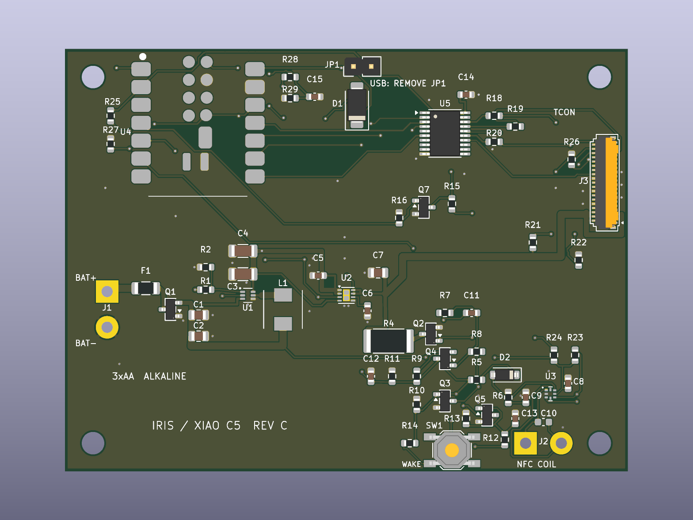

# AirDrop ChLCD Photo Frame — Hardware

Open carrier-board design for a color **ChLCD e-paper photo frame** using a Seeed XIAO ESP32-C5, IRIS AW1005S102 panel and matching IRIS TCON. Photos arrive through native iPhone AirDrop and are processed locally by the C5.

**[Firmware and project overview](https://github.com/Benv-B/ESP32Drop) · [Assembly details / 中文](hardware/iris_xiao_c5_revC/README.md)**

## ChLCD, AirDrop and an open carrier

ChLCD is cholesteric liquid crystal e-paper. It differs from the electrophoretic technology used by E Ink Spectra 6. The purchased IRIS panel is 1024 × 768 pixels; this project supplies the carrier design and firmware integration, not a new display material or a replacement for the IRIS TCON internals.

The AirDrop path requires no companion app, account, cloud service or Wi-Fi router. The board also includes NFC-triggered power latching; NFC wakes the board and does not transmit the photo. Long-term battery runtime and a complete battery-only NFC wake → display → shutdown cycle still need validation.

References: [IRIS ChLCD](https://iris-opt.com/en/about/) · [E Ink Spectra 6](https://shopkits.eink.com/en/product/detail/7.3%27%27Spectra6ePaperDisplay).

## Files you can use

| Item | Location |
| --- | --- |
| Editable KiCad project / routed PCB / schematics | [hardware/iris_xiao_c5_revC](hardware/iris_xiao_c5_revC) |
| Schematic PDF | [IRIS_C5_RevC_schematic.pdf](hardware/iris_xiao_c5_revC/output/IRIS_C5_RevC_schematic.pdf) |
| Bill of materials | [BOM.csv](hardware/iris_xiao_c5_revC/output/BOM.csv) |
| Historical component sourcing notes | [PROCUREMENT.md](hardware/iris_xiao_c5_revC/PROCUREMENT.md) |
| Fabrication, paste and drill files | [Gerbers](hardware/iris_xiao_c5_revC/output/gerbers) |
| PCB checks and previews | [PCB output](hardware/iris_xiao_c5_revC/output/pcb) |
| Firmware | [Benv-B/ESP32Drop](https://github.com/Benv-B/ESP32Drop) |

Use **KiCad 10.0.6 or a compatible newer version** for the saved PCB. Open the saved project directly; do not rerun an initial-placement script over the routed board. Historical generation scripts reference the original research workspace and are not required to open the design.

## Board and assembly

- 80 × 60 mm, two copper layers, four 3.2 mm mounting holes.
- XIAO ESP32-C5 with 8 MB flash / 8 MB PSRAM.
- NT3H2111 NFC front end with external coil and power-latch circuit.
- Three primary alkaline AA cells; TPS61023 boost stage and TPS22975 power switch.
- 39-pin FPC interface for the matching IRIS TCON; Hirose FH26W-39S-0.3SHW(60).

For the documented setup, close JP1 for normal battery operation and remove it for USB debugging. The XIAO underside pads must be soldered as documented. Connect the AA pack to the carrier BAT+/BAT− input, not the XIAO Li-ion battery pads. Read the [full assembly and FPC notes](hardware/iris_xiao_c5_revC/README.md) before building.

## Validation status — 22 October 2026

The saved routed-board snapshot has recorded ERC/DRC and netlist checks. A physical prototype has displayed both a color-bar pattern and photos received through AirDrop. Progressive photo display has also worked. These results do not establish production readiness, universal phone compatibility, battery runtime or validated power transients. See the firmware's [dated test notes](https://github.com/Benv-B/ESP32Drop/blob/main/docs/iris-tcon.md).

The PCB published here is the saved 16 October 2026 18:33 routing revision, with its matching generated outputs. The separate earlier working-directory export is not substituted for it.

## License and attribution

The original carrier-board design is copyright (c) 2026 Benv-B and licensed under **[CERN-OHL-P-2.0](LICENSE)**. Project-owned design scripts are [0BSD licensed](LICENSES/0BSD.txt). Third-party symbols and footprints retain their upstream terms; see [THIRD_PARTY_NOTICES.md](THIRD_PARTY_NOTICES.md) and the bundled license texts.

The IRIS panel, TCON internals, vendor firmware, waveforms, calibration and supplier manuals are outside this project's open-source license. Obtain the matched hardware and documents from the supplier. This design does not imply endorsement by IRIS, Seeed, Apple or E Ink. Development and documentation were assisted by AI; simulation, static checks and physical observations are identified separately.

## 中文

本仓库开放 **自制相框载板** 的 KiCad、原理图、BOM 和 Gerbers，软件见[固件仓库](https://github.com/Benv-B/ESP32Drop)。项目采用 IRIS AW1005S102 **ChLCD 胆甾相液晶彩色电子纸**，与 Spectra 6 的电泳技术不同；目前未进行同条件画质/速度对照，不宣称优于 Spectra 6。

实板已经显示色条和 iPhone AirDrop 照片。NFC 唤醒、自动关机是设计功能，整套电池独立流程及续航仍需验证。开源的是载板和项目固件，不包括商用屏幕/TCON 内部固件、波形或厂商私有资料。

硬件采用 CERN-OHL-P-2.0，项目脚本采用 0BSD，第三方库保留原许可。装配细节请阅读[RevC 说明](hardware/iris_xiao_c5_revC/README.md)。
